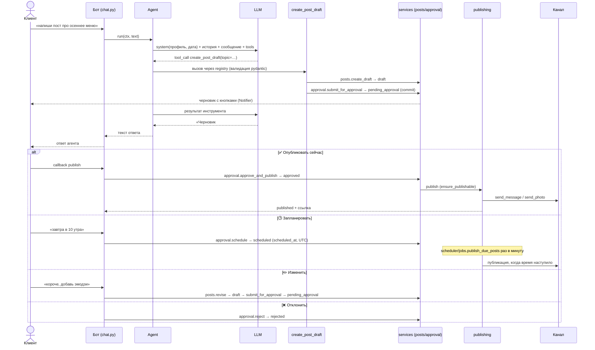
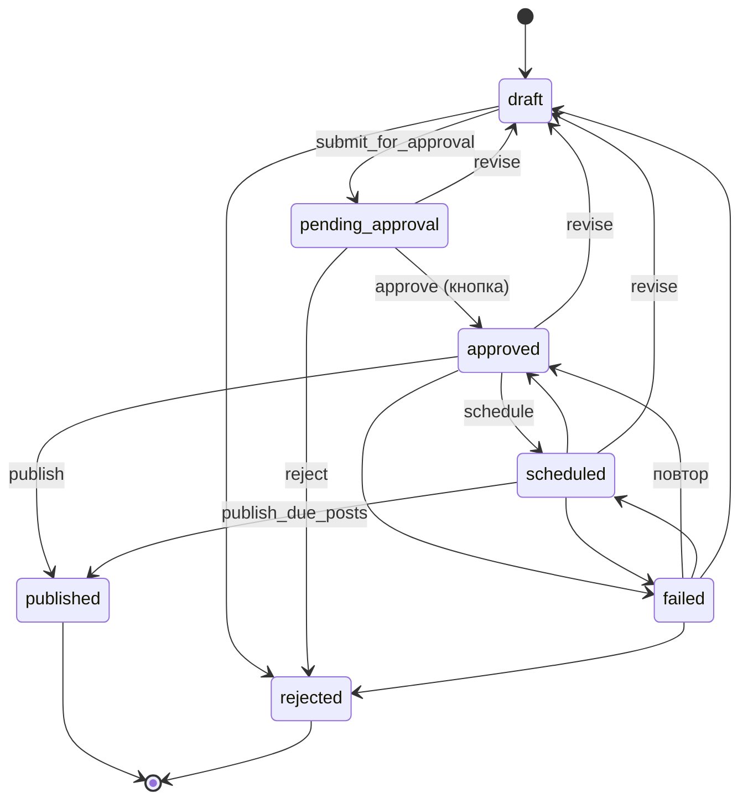

# Архитектура

## Слои

```mermaid
flowchart TB
    subgraph TG[Telegram]
        U[Клиент в личке бота]
        CH[Telegram-канал]
    end

    subgraph BOT[app/bot — тонкий UI]
        MW[middlewares<br/>сессия БД + доступ + компания]
        H[handlers<br/>start · onboarding · approval · admin · chat]
        N[BotNotifier]
    end

    subgraph AG[app/agent]
        CORE[core.Agent<br/>цикл LLM ↔ инструменты]
        REG[registry<br/>@tool + JSON-схемы]
        TOOLS[tools/*<br/>profile · post · plan · analytics]
        PR[prompts/*.md]
    end

    subgraph SV[app/services — бизнес-логика]
        BP[business_profile]
        PS[posts<br/>машина состояний]
        AP[approval<br/>единственный, кто разрешает публикацию]
        PUB[publishing<br/>ensure_publishable + dry-run]
        PLAN[content_plan · темы, даты и согласование]
        AN[analytics · reports · usage · comments · media]
    end

    subgraph INF[Инфраструктура]
        LLM[llm/*<br/>mock · openai]
        IMG[images/*<br/>mock · openai]
        PBL[publishers/*<br/>telegram · vk · max]
        ING[ingestion<br/>documents · website]
        DB[(SQLite<br/>db/models + repositories)]
        SCH[scheduler<br/>публикация по времени · автоотчёты]
    end

    U --> MW --> H
    H -->|свободный текст| CORE
    H -->|кнопки, онбординг| SV
    CORE --> REG --> TOOLS --> SV
    CORE --> LLM
    CORE --> PR
    BP --> LLM
    BP --> ING
    PS --> LLM
    PS --> IMG
    AP --> PUB --> PBL --> CH
    SV --> DB
    SCH --> PUB
    SCH --> AN
    SCH --> PLAN
    AP -.->|Notifier| N --> U
    SCH -.->|Notifier| N
```

Правило зависимостей: `bot → services → (db, llm, images, publishers)`. `agent/tools → services`.
Сервисы не импортируют aiogram и общаются с пользователем через протокол `Notifier`
(`app/services/notifier.py`).
Зависимости собираются в `app/container.py` и попадают в хендлеры через aiogram DI (аргумент
`container`).

## Сценарий «сообщение → агент → черновик → согласование → публикация»



## Машина состояний поста



Переходы описаны в одном месте — `ALLOWED_TRANSITIONS` в `app/services/posts.py`. Недопустимый
переход вызывает `InvalidTransitionError`. Публикация возможна только из `approved`/`scheduled`.
Это проверяет `ensure_publishable()` в сервисном слое, а не только интерфейс.

## Агент

- **Реестр** (`app/agent/registry.py`): `@tool(name, description)` над
  `async def f(ctx: AgentContext, args: Model)`. JSON-схема генерируется из pydantic-модели.
  Ошибки инструмента не падают наружу, а возвращаются модели как `{"error": ...}`.
  `NotImplementedError` превращается в `{"status": "in_development"}`.
- **Цикл** (`app/agent/core.py`): не больше `AGENT_MAX_STEPS` шагов, таймаут на каждый шаг,
  повторы с экспоненциальной паузой при сетевых ошибках делает `openai_provider` через
  `utils/retry.py`. История хранится в `agent_messages`, окно — `AGENT_HISTORY_LIMIT`
  сообщений, обрезанное до первого сообщения пользователя.
- **Mock-LLM** (`app/llm/mock_provider.py`) выбирает инструмент по ключевым словам и пишет
  шаблонные посты. Сквозной сценарий работает без ключей и сети.

## Данные

Таблицы: `users`, `businesses` (профиль в JSON), `sources`, `channels`, `posts`,
`post_revisions`, `content_plans`, `content_plan_items`, `agent_messages`, `event_log`,
`post_metrics`, `usage_records`, `comments`, `media_files`.
Таблицы создаются через `create_all` при старте. Имена ограничений заданы явно
(`NAMING_CONVENTION`), чтобы позже подключить Alembic. Enum-ы хранятся как VARCHAR со
значением.

`event_log` — журнал событий (создание, согласование, публикация, ошибки). Он доступен администратору через `/log`. Отчёты используют также данные о постах, реакциях,
комментариях и расходах.
